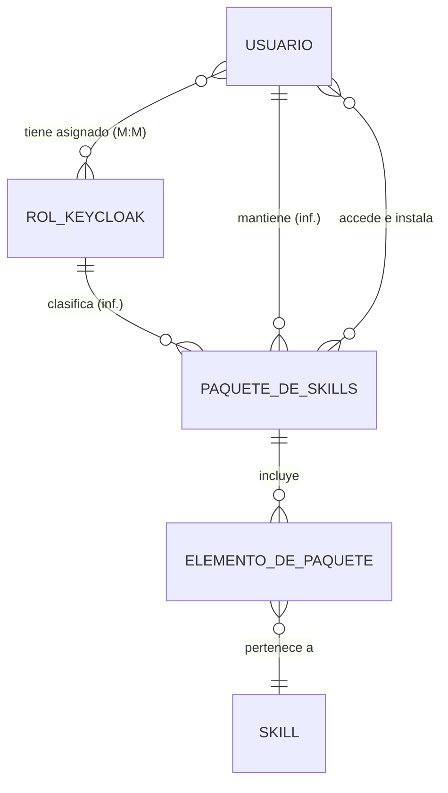
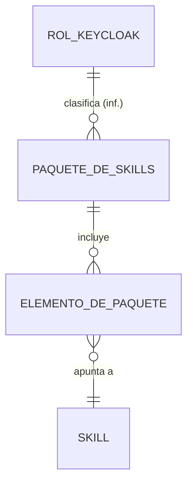

# IMD-001 — Modelo de información conceptual de paquetes de Skills

> **Qué es y qué no es:** es un modelo **conceptual**. Muestra qué conceptos de negocio existen y cómo se relacionan. **No** es un modelo de datos: no define tablas, atributos técnicos, identificadores ni persistencia (eso corresponde a `data-model-designer`).
>
> **Procedencia:** Context Pack RCP-2026-10-05-SKILLS-PACKAGES, User Story US-001 y registro local de Skills. Las relaciones marcadas **(inf.)** son inferencias. El detalle de cada relación está en la sección 5.

## 1. Vista general

El dominio describe cómo usuarios con roles Keycloak `author` o `admin` mantienen paquetes públicos de Skills asociados a un rol. El paquete conserva referencias a Skills existentes; sus elementos representan únicamente pertenencia. Un paquete publicado permanece usable, aunque puede adoptar el estado `published_with_deprecated_or_retired_skills` cuando contiene Skills deprecados o retirados.

## 2. Diagrama — composición del paquete

**Conceptos derivados** (se calculan, no se registran):

- **Cobertura de rol — (derivado):** conjunto de Skills alcanzado por un paquete asociado a un rol. No se registra como concepto independiente.

## 3. Diagrama — ejemplo de composición funcional

El ejemplo de Analista Funcional es una instancia propuesta, no una decisión validada. Sus referencias candidatas son `af-user-story-refiner`, `af-business-rule-extractor`, `af-business-glossary-curator`, `af-conceptual-model-designer`, `af-requirement-context-builder` y, sujeto a confirmación de registro, `af-requirements-orchestrator`.

## 4. Conceptos

| Concepto | Nombre en diagrama | Qué es | Bloque | Glosario | Fuente | Horizonte |
|---|---|---|---|---|---|---|
| Usuario | USUARIO | Persona o identidad con roles Keycloak; puede mantener paquetes si posee `author` o `admin`. | Gobierno | Sin término; IM-Q6 | RCP:E-005; Q-001,Q-002 | H1 |
| Rol Keycloak | ROL_KEYCLOAK | Rol definido en Keycloak y asignado a usuarios; clasifica el paquete y gobierna el mantenimiento. | Gobierno | Sin término; IM-Q6 | RCP:E-005; Q-002 | H1 |
| Paquete de Skills | PAQUETE_DE_SKILLS | Conjunto gobernado y público de referencias a Skills relacionados para un rol. | Catálogo | Sin término; IM-Q6 | RCP:E-001,E-006,E-009 | H1 |
| Elemento de paquete | ELEMENTO_DE_PAQUETE | Unidad de pertenencia que vincula un paquete con un Skill; no expresa orden ni dependencia por ahora. | Composición | Sin término; IM-Q6 | RCP:E-007; Q-004 | H1 |
| Skill | SKILL | Unidad de capacidad reutilizable registrada en el catálogo y referenciable por un paquete. | Catálogo | Sin término; IM-Q6 | RCP:E-002; `/.agents/skills/` | H1 |

## 5. Relaciones

Clasificación: **FACT** (lo dice la fuente), **INFERENCE** (deducción razonada desde fuentes citadas), **UNKNOWN** (necesario pero sin respaldo) y **RETIRADA** (ya no aplica, con motivo).

| ID | Relación | Cardinalidad | Clasificación | Fuente | Pregunta |
|---|---|---|---|---|---|
| R-01 | Un usuario tiene uno o más `Role` y un `Role` puede estar asignado a varios usuarios. | M : N | FACT: la relación fue confirmada; su representación física actual usa un arreglo JSON. | RCP:E-013,E-012; `src/lib/db/schema.ts` | — |
| R-02 | Un `Role` puede asociarse conceptualmente a varios paquetes y un paquete a varios `Role`. | M : N | FACT: la asociación se mantiene solo como concepto y no se implementará explícitamente. | RCP:E-014 | — |
| R-03 | Un usuario con `author` o `admin` mantiene paquetes y debe quedar identificado como creador o mantenedor. | FACT | La decisión humana confirma que se registra quién creó y quién mantiene cada paquete; queda pendiente solo la cardinalidad del responsable actual y la retención de auditoría. | RCP:E-005,Q-001; decisión humana 2026-10-07 | IM-Q3 |
| R-04 | Un paquete incluye elementos de paquete. | 1 : N | FACT: el alcance incorpora uno o más Skills. | RCP:Incluido; E-006 | — |
| R-05 | Un elemento pertenece a un Skill referenciado. | N : 1 | FACT: las relaciones son de pertenencia. | RCP:E-002,E-007 | — |
| R-06 | Un Skill puede pertenecer a varios paquetes y un paquete puede incluir varios Skills. | M : N | FACT: la relación Skill–paquete fue confirmada como muchos a muchos. | RCP:E-015 | — |
| R-07 | Un usuario puede acceder e instalar paquetes. | M : N | FACT: el acceso e instalación no dependen de los `Role` del usuario. | RCP:E-014; E-009 | — |

## 6. Reglas que actúan sobre el modelo

| Regla | Sobre qué concepto | Qué impone |
|---|---|---|
| BR-PKG-001 (propuesta) | Elemento de paquete | La referencia debe apuntar a un Skill canónico y no duplicar su contenido. | RCP-2026-10-05-SKILLS-PACKAGES:E-002,E-003 |
| BR-PKG-002 (propuesta) | Paquete de Skills | El paquete debe declarar el `Role` al que está dirigido. | RCP-2026-10-05-SKILLS-PACKAGES:E-001,E-005 |
| BR-PKG-003 (propuesta) | Mantenimiento | Solo usuarios con rol Keycloak `author` o `admin` pueden crear o mantener paquetes. | RCP-2026-10-05-SKILLS-PACKAGES:E-005 |
| BR-PKG-004 (propuesta) | Estado | Estados mínimos: `draft`, `published`, `published_with_deprecated_or_retired_skills` y `retired`. | RCP-2026-10-05-SKILLS-PACKAGES:E-008,Q-006 |
| BR-PKG-005 (propuesta) | Estado | `published_with_deprecated_or_retired_skills` mantiene el paquete publicado y usable, pero advierte que contiene Skills deprecados o retirados. | RCP-2026-10-05-SKILLS-PACKAGES:E-008 |
| BR-PKG-006 (propuesta) | Composición | La relación entre paquete y Skill es únicamente de pertenencia; orden, dependencia y obligatoriedad están fuera de alcance actual. | RCP-2026-10-05-SKILLS-PACKAGES:E-007 |

## 7. Preguntas abiertas del modelo

| ID | Pregunta | Afecta a | Responsable | Prioridad |
|---|---|---|---|---|
| IM-Q1 | ¿Cuál es la cardinalidad exacta entre usuario y `Role`? | R-01 | PO / ARQ | Media — Cerrada: M : N |
| IM-Q2 | ¿Puede un `Role` tener varios paquetes y un paquete asociarse a más de un `Role`? | R-02 | PO / Negocio | Alta — Cerrada: relación solo conceptual, no explícita |
| IM-Q3 | ¿Debe registrarse quién creó o mantiene cada paquete, además de los `Role` asociados? | R-03 | PO / ARQ | Media — Cerrada: sí; registrar quién creó y quién mantiene cada paquete. |
| IM-Q4 | ¿Puede un Skill pertenecer a varios paquetes? | R-06 | PO / ARQ | Alta — Cerrada: M : N |
| IM-Q5 | ¿Qué reglas concretas deben gobernar la versión del paquete y el resultado de instalar o ejecutar varios Skills? | PAQUETE_DE_SKILLS | ARQ / DEV | Alta — Abierta: pregunta reformulada |
| IM-Q6 | ¿Qué conceptos del modelo deben formalizarse en el glosario? | Todos | `af-business-glossary-curator` / PO | Media — Cerrada: todos |

## 7.1 Respuestas propuestas a las preguntas abiertas

Las siguientes respuestas cierran el contenido conceptual de IM-Q3 e IM-Q5 como propuesta trazable. No equivalen todavía a una aprobación humana de producto o arquitectura.

### IM-Q3 — Auditoría de mantenimiento

**Respuesta propuesta:** sí, el paquete debe identificar al usuario responsable de su mantenimiento y conservar la trazabilidad de las acciones relevantes: crear, editar, publicar y retirar. El `Role` (`author` o `admin`) determina la autorización, pero no sustituye la identidad del actor.

**Decisión conceptual:** mantener la relación `Usuario mantiene Paquete de Skills` y enriquecerla con responsabilidad actual y eventos de mantenimiento. La cardinalidad exacta del responsable actual y la retención de auditoría quedan pendientes de validación de PO/ARQ.

**Base:** US-001, secciones 9 y 10; RCP E-005; el modelo ya identifica a `Usuario` como mantenedor potencial.

### IM-Q5 — Versionado, instalación y ejecución

**Respuesta propuesta:** cada versión publicada del paquete debe ser un snapshot inmutable que conserve las referencias y versiones exactas de sus Skills. Una modificación de composición o referencia genera una nueva versión; no se actualiza silenciosamente una versión publicada.

La descarga y la instalación deben operar sobre una versión concreta del snapshot. La ejecución del paquete no introduce orden, dependencia ni atomicidad implícitos: invoca cada Skill de forma independiente conforme a su contrato y reporta el resultado de cada elemento junto con un resultado global derivado. Una ejecución parcialmente fallida no debe presentarse como exitosa.

**Límites pendientes:** reintentos, compensación, rollback y comportamiento exacto cuando una versión de Skill fijada ya no está disponible requieren validación de ARQ/DEV. Se conserva la regla existente de que un paquete publicado con Skills deprecados o retirados permanece usable y visible con advertencia.

**Base:** RCP E-006, E-008 y S-01/S-04; US-001 sección 9; US-002 AC-1..AC-3 y casos negativos.

## 8. Historial de cambios del modelo

| Fecha | Cambio | Relaciones o conceptos afectados | Fuente |
|---|---|---|---|
| 2026-10-05 | Actualización por respuestas del RCP: cardinalidad M:N usuario–Role, asociación Role–paquete solo conceptual, acceso público independiente de roles y cardinalidad M:N Skill–paquete. | USUARIO, ROL_KEYCLOAK, PAQUETE_DE_SKILLS, ELEMENTO_DE_PAQUETE, R-01..R-07 | RCP-2026-10-05-SKILLS-PACKAGES; US-001; US-002; `src/lib/db/schema.ts` |

## 9. Preparación y validación

- **Estado:** CONDITIONAL para pasar a `data-model-designer`
- **Motivo:** Las cardinalidades usuario–Role y Skill–paquete están confirmadas como M:N. La asociación Role–paquete es conceptual; faltan aclarar la auditoría de mantenimiento, las reglas de versionado/ejecución y formalizar los términos en el glosario. La representación física actual de roles usa JSON.
- **Validación por bloque:**
  - [x] Gobierno y autorización — RCP Q-001/Q-002/Q-005/Q-006
  - [x] Composición — RCP Q-004
  - [x] Visibilidad y consumo — RCP Q-003/Q-008
  - [x] Cardinalidad usuario–Role — IM-Q1 / RCP E-013
  - [x] Cardinalidad Skill–paquete — IM-Q4 / RCP E-015
  - [x] Decisión humana sobre auditoría de mantenimiento — IM-Q3: registrar quién creó y quién mantiene cada paquete.
  - [ ] Definir cardinalidad del responsable actual y retención de auditoría — IM-Q3
  - [ ] Instalación, descarga, ejecución y versiones — IM-Q5

## 10. Decisiones humanas registradas

- **IM-Q3 — Cerrada:** se debe registrar quién creó y quién mantiene cada paquete, además de los `Role` asociados. Fuente: decisión humana del 2026-10-07.
